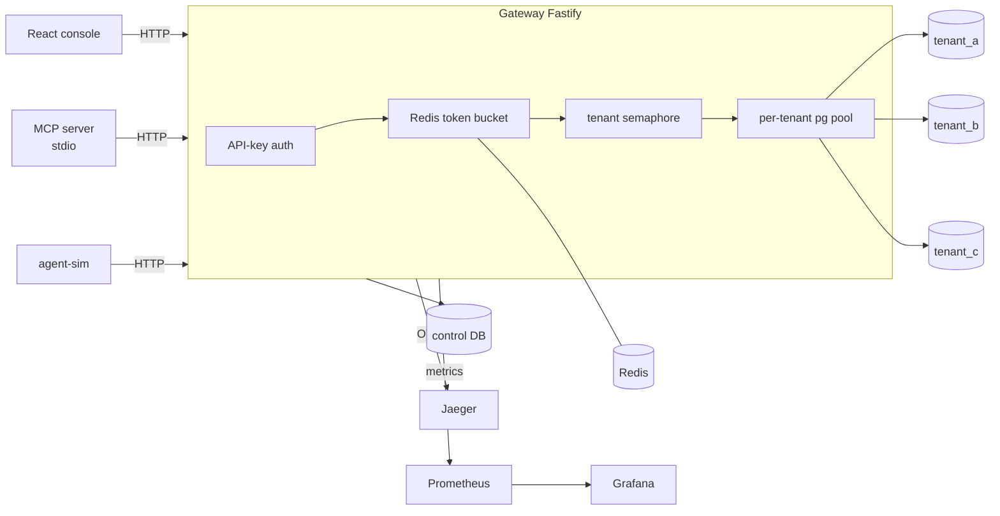

# PG Agent Gateway

[](https://github.com/mini4141/pg-agent-gateway/actions/workflows/ci.yml)

A multi-tenant SQL execution service for dashboards, MCP tools and AI agents. A Fastify gateway runs SQL against many tenants' Postgres databases while staying fair under agent-scale load: per-tenant pools, Redis rate limits, statement timeouts, cancellation, streaming and load shedding. It has SLO-grade observability and ships to AWS through canary rollouts.

Status and checklists: [PROGRESS.md](PROGRESS.md). Proof: [proof/README.md](proof/README.md). Write-up: [docs/PORTFOLIO.md](docs/PORTFOLIO.md). Caller contract: [docs/CONTRACT.md](docs/CONTRACT.md).

## Architecture



## Quickstart (Windows + Docker Desktop, Git Bash)

```bash
pnpm install
scripts/dev-up.sh      # compose up + seed; console at http://localhost:8080/console
scripts/test-all.sh    # unit, contract, e2e, load smoke
scripts/dev-down.sh
```

Grafana http://localhost:3000, Jaeger http://localhost:16686, Prometheus http://localhost:9090, OpenAPI http://localhost:8080/docs.

## Deploy / destroy (AWS, `ap-southeast-2`, profile `pg-agent-gateway-deployer`)

```bash
scripts/deploy.sh      # CDK bootstrap + deploy, DB init, smoke, canary promote + rollback
scripts/destroy.sh     # empties ECR, cdk destroy, removes toolkit stack
scripts/verify-destroyed.sh
```
