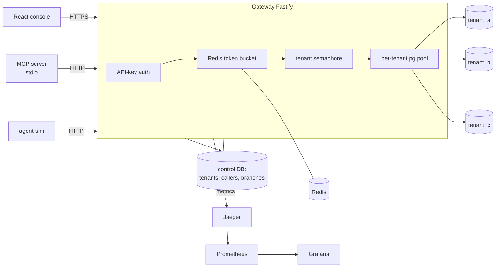

# SPECS.md: PG Agent Gateway

## 1. Summary

A multi-tenant backend service that runs SQL against customers' Postgres databases on behalf of three kinds of caller:

- a **web console** (human),
- an **MCP server** (tools for AI assistants), and
- **simulated AI agents** (bursty automated traffic).

Its job is to stay **reliable, observable and fair between tenants at agent scale**. It does that with per-tenant pooling, rate limiting, timeouts and cancellation, streaming for large results, load shedding and a written caller contract. It also serves per-branch config and secrets to code-first workflows. It ships to AWS through staged canary rollouts with automatic rollback.

**Demo story:**
1. Run a query in the console and watch rows stream in.
2. An agent swarm floods tenant A. Tenant A gets 429s, while tenant B's latency SLO holds.
3. A runaway query is cancelled at its timeout.
4. A canary goes 10 → 50 → 100%.
5. A bad canary rolls back on its own.

## 2. Requirement coverage matrix

| Requirement | Covered by | Proof |
|---|---|---|
| Run SQL against customers' Postgres for dashboard, MCP and agents | F1 query API, F2 console, F3 MCP server, F4 agent-sim | Screenshots + MCP log |
| Reliable, observable, fair between tenants at agent scale | F5 fairness pipeline + noisy-neighbour test | Load-test report, Grafana |
| Connection reuse, limit/stream large results, isolate and rate-limit tenants | Per-tenant pools, NDJSON streaming, `maxRows`, token bucket, semaphore | Contract tests |
| SLOs + observability: per-tenant/per-caller metrics, alerts, searchable logs | F6: prom metrics, recording rules, burn-rate alerts, pino logs, OTel traces | Grafana SLO board, alert log |
| Canary and staged rollouts, safe deploys | F8 canary script with automatic rollback | Promotion + rollback logs |
| Written contract with callers: transactions, multi-statement, timeouts, errors | `docs/CONTRACT.md` + OpenAPI + contract tests | Test report |
| Rate limiting, timeouts, memory limits, graceful degradation | under-pressure, max response bytes, container memory limits | Logs |
| Branch config and secrets for code-first workflows | F7 branch config endpoint, KMS/Secrets Manager | Test + log |
| On-call, runbooks, incidents, postmortems | `docs/runbooks/*.md` (3 runbooks), `docs/postmortems/2026-xx-noisy-neighbour.md` (written from the drill) | Docs |
| Securing a service that runs SQL for callers | Restricted roles, READ ONLY for agents, encrypted creds, API-key hashing | Tests |

## 3. Architecture



AWS: ALB (weighted TGs: stable 100 / canary 0) → ECS Fargate `gateway-stable` and `gateway-canary`, plus an ECS `redis` service (Service Connect) → RDS Postgres (control + 3 tenant DBs on one instance). Secrets Manager + KMS. ADOT sidecar → X-Ray. CloudWatch EMF metrics, alarms and a dashboard.

## 4. Repository layout

```
apps/gateway/        Fastify service (src/routes, src/pipeline, src/pg, src/obs, src/secrets)
apps/console/        React + Vite
apps/mcp-server/     MCP server (stdio + HTTP to gateway)
tools/agent-sim/     traffic generator + noisy-neighbour scenario
db/                  init SQL: control schema, tenant DBs, roles, sample data (pagila-like synthetic)
observability/       prometheus.yml, rules/slo.yml, grafana/dashboards/*.json
infra/               CDK app (lib/network, lib/data, lib/service, lib/canary)
docs/                CONTRACT.md, runbooks/, postmortems/, DECISIONS.md, PORTFOLIO.md
scripts/             dev-up.sh, test-all.sh, canary.sh, deploy.sh, destroy.sh, capture-proof.sh ...
```

## 5. Features (end-to-end)

### F1: Query API
- `POST /v1/tenants/:tenant/query` with headers `x-api-key` and `x-caller-type: console|mcp|agent` and body `{sql, params?, maxRows?, timeoutMs?, stream?}`.
- Non-stream response: `{rows, fields, rowCount, truncated, durationMs}`.
- Stream response: NDJSON, one line per row, then a trailer line `{_meta:{rowCount, truncated}}`.
- Postgres connections are reused per tenant (`pg.Pool`, max 5, idle 30 s). `statement_timeout` is set per transaction. If the client disconnects or the timeout hits, the server calls `pg_cancel_backend(pid)`.
- **Accept:** `SELECT * FROM generate_series(1,100000)` with `stream=true` streams all rows while memory stays flat; with `maxRows=1000` it returns `truncated:true`; `SELECT pg_sleep(10)` with `timeoutMs=500` returns 408 `STATEMENT_TIMEOUT`.

### F2: Console (web)
- `/console`: tenant picker, SQL editor (textarea is fine), Run, streamed results table with a row counter and duration.
- `/tenants`: a live table of per-tenant RPS, p95, 429 count and pool usage (polls `/v1/admin/stats`).
- **Accept:** in Playwright, running a query shows rows.

### F3: MCP server
- Tools: `list_tables(tenant)`, `describe_table(tenant, table)`, `run_sql(tenant, sql)` (read-only).
- It ships with a tiny MCP client script (`apps/mcp-server/scripts/demo-client.ts`) that lists the tools and calls each one. The output is logged.
- **Accept:** the demo client prints the table list and a query result.

### F4: Agent traffic simulator
- `agent-sim --tenant tenant_a --rps 300 --duration 60s --pattern bursty` against a background of `--tenant tenant_b --rps 20`.
- **Accept:** a report JSON shows tenant A receiving 429/503 responses, while tenant B's p95 stays under 300 ms and its errors stay below 1%.

### F5: Fairness and degradation pipeline
- Token bucket (Redis Lua) keyed by `tenant:caller_type`, with limits from the control DB. Per-tenant semaphore of 5 in-flight queries, with a bounded wait queue (10, timeout 2 s).
- `@fastify/under-pressure` returns 503 when event-loop lag exceeds 200 ms or the heap exceeds its limit. The response body is capped at `MAX_RESPONSE_BYTES` (non-stream).
- **Accept:** covered by F4, plus a unit test for the Lua bucket.

### F6: Observability and SLOs
- Metrics:
  - `gw_requests_total{tenant,caller_type,code}`
  - `gw_request_duration_seconds` (histogram)
  - `gw_pool_in_use{tenant}`
  - `gw_ratelimited_total`
  - `gw_cancelled_queries_total`
- SLOs: availability ≥ 99.5% (non-429 5xx count as bad) and p95 latency < 300 ms for `console`. Prometheus recording rules plus multi-window burn-rate alerts route to an Alertmanager webhook logger.
- Every request gets a trace with spans for auth, rate limit, semaphore wait, pool acquire and query.
- Logs are pino JSON with `reqId`, `tenant`, `callerType` and `durationMs`, without SQL text.
- **Accept:** the Grafana "Gateway SLO" dashboard shows data during F4, and a Jaeger trace shows all the spans.

### F7: Branch config and secrets
- `PUT /v1/projects/:p/branches/:b/config` stores `{config, secrets}`, with the secrets encrypted. `GET` returns the decrypted payload only to a caller with the `platform-worker` role.
- **Accept:** round-trip test. Locally the data key comes from a file; on AWS, secrets are stored in Secrets Manager and the data key is KMS-wrapped.

### F8: Canary and staged rollout (AWS)
- `scripts/canary.sh <tag>` does the following:
  1. Updates the canary service to the new image.
  2. Waits until it is stable.
  3. Shifts the ALB listener weights 10 → 50 → 100, baking 3 minutes at each step.
  4. Checks the `canary-5xx` alarm at each step.
  5. On success, promotes the tag to stable and resets the weights to 100/0. On alarm, sets the weights back to 100/0 and logs `ROLLBACK`.
- **Accept:** one promotion log and one rollback log (the image tag with `FAULT=500`).

## 6. Data model (control DB)

- `tenants(id, name, db_host, db_name, db_user, enc_password, enc_data_key, rate_limit_rps, max_concurrency)`
- `callers(id, tenant_id, type, api_key_hash, role)`
- `branches(project, branch, config jsonb, enc_secrets bytea, updated_at)`

The tenant DBs use the same synthetic schema (`customers`, `orders`, `products`, ~50k rows) owned by a non-superuser role `tenant_rw` with a read-only role `tenant_ro`.

## 7. Interfaces

- `POST /v1/tenants/:tenant/query`
- `GET /v1/tenants/:tenant/tables`
- `GET /v1/admin/stats`
- `PUT|GET /v1/projects/:p/branches/:b/config`
- `GET /healthz` (liveness)
- `GET /readyz` (checks the control DB and Redis)
- `GET /metrics`
- `GET /docs` (OpenAPI UI)

## 8. Test plan

| Layer | Test |
|---|---|
| Unit | Token bucket allows N then denies; contract error serializer |
| Contract | One per CONTRACT.md behaviour: transaction commit, multi-statement, timeout → 408 + cancelled, truncation, stream trailer, read-only agent write → 403 |
| e2e | Playwright console query |
| Load | agent-sim noisy-neighbour assertion (report JSON thresholds) |

## 9. Phase 1: Local

`docker compose` runs postgres (control + 3 tenants), redis, prometheus, grafana, jaeger, the gateway and the console. `scripts/dev-up.sh` brings it all up and seeds it.

- [ ] `tests/`: Vitest JUnit, Playwright report, `agent-sim-report.json`
- [ ] `screenshots/01-console-stream.png`, `02-tenants-live.png`, `03-grafana-slo.png`, `04-jaeger-trace.png`, `05-openapi-docs.png`
- [ ] `logs/mcp-demo-client.log`, `logs/timeout-cancel.log` (shows `pg_cancel_backend` + 408), `logs/alertmanager-webhook.log`
- [ ] `docs/postmortems/…-noisy-neighbour.md` written from the drill

## 10. Phase 2: AWS

| Local | AWS |
|---|---|
| compose Postgres | RDS PostgreSQL db.t4g.micro (one instance, 4 databases), private subnets, no NAT; tasks run in public subnets with public IPs and SG-restricted DB access |
| compose Redis | ECS Fargate `redis` service reached through Service Connect |
| gateway container | ECS Fargate `gateway-stable` + `gateway-canary`, ALB with weighted target groups |
| local key file | KMS CMK + Secrets Manager |
| Prometheus/Grafana/Jaeger | CloudWatch EMF metrics + alarms + dashboard, X-Ray via ADOT sidecar |

`scripts/deploy.sh`:
1. `cdk bootstrap` (project qualifier).
2. `cdk deploy`.
3. Run the DB init through a one-off ECS task.
4. Smoke test.
5. `canary.sh` good tag, then `canary.sh` faulty tag.

- [ ] `logs/canary-promote.log`, `logs/canary-rollback.log`, `logs/cdk-deploy.log` (redacted), `resources.txt`
- [ ] `screenshots/01-cloud-console.png`, `02-cloudwatch-latency.png` and `03-cloudwatch-5xx-during-rollback.png` (via `get-metric-widget-image`)
- [ ] `logs/xray-trace-summary.json`
- [ ] `tests/cloud-contract/` (the contract tests run against the ALB URL)

## 11. Phase 3: Destroy

`scripts/destroy.sh`:
1. `cdk destroy --all --force`.
2. Delete `CDKToolkit-pg-agent-gateway` and its bucket.
3. Schedule the KMS key for deletion (7 days minimum; note it in the log).

`verify-destroyed.sh` checks:
- no ECS cluster, ALB, RDS instance or Secrets Manager secrets with the project tag;
- the KMS key is in `PendingDeletion`.

## 12. Out of scope

Multi-region, a real auth provider, SQL parsing/allow-listing, pgbouncer, and an Elixir/Go second implementation.
