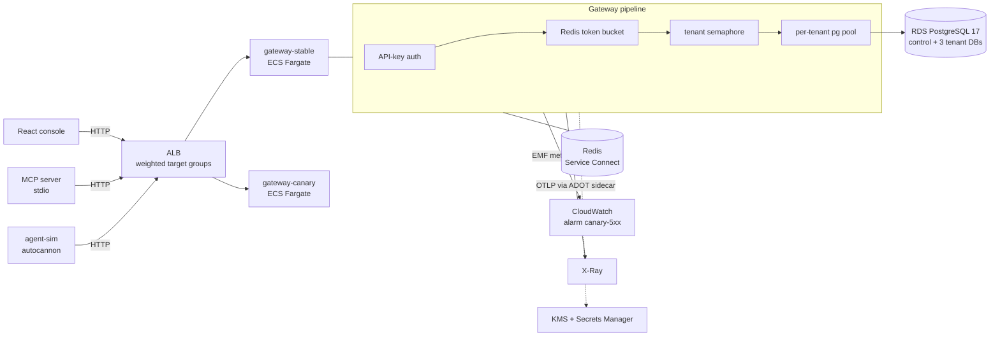
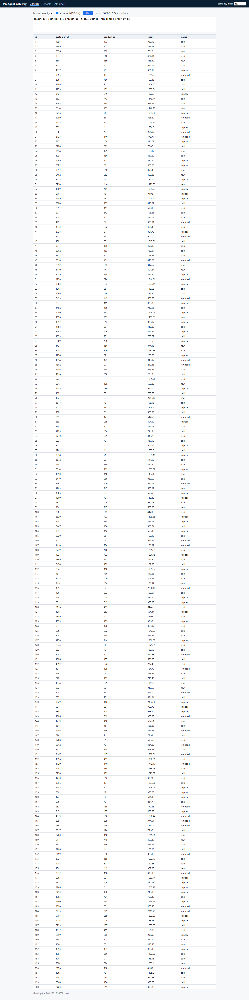
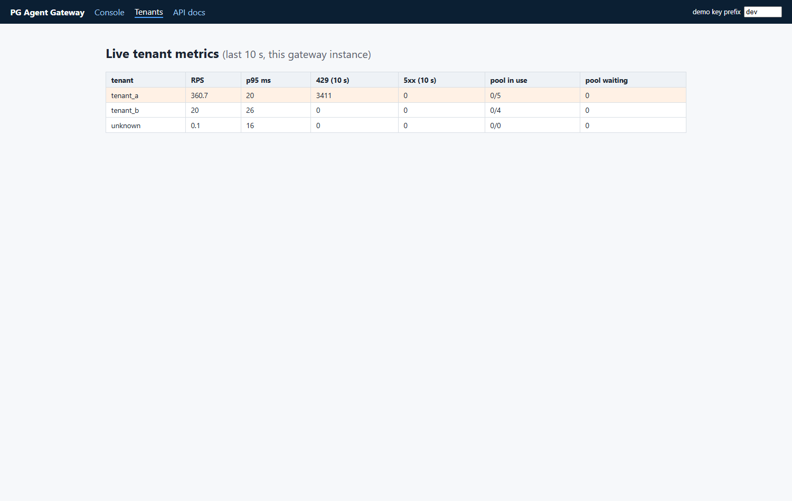
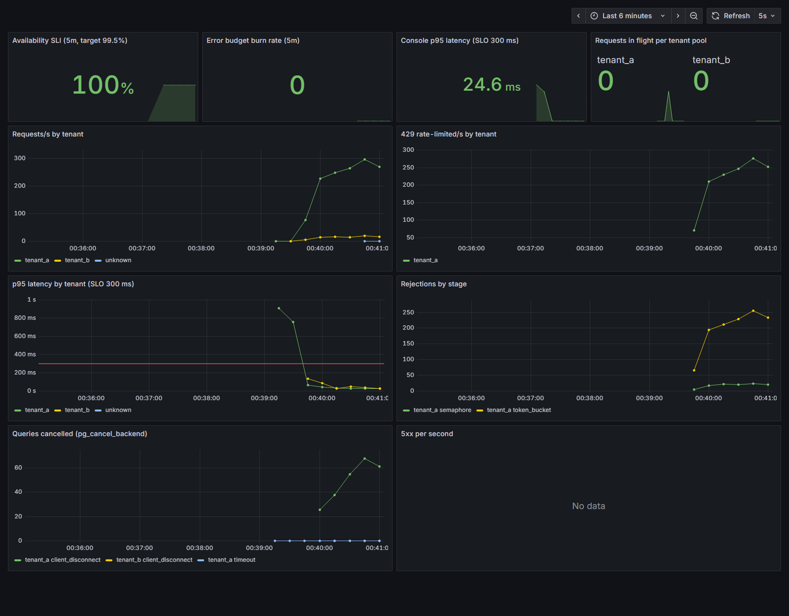
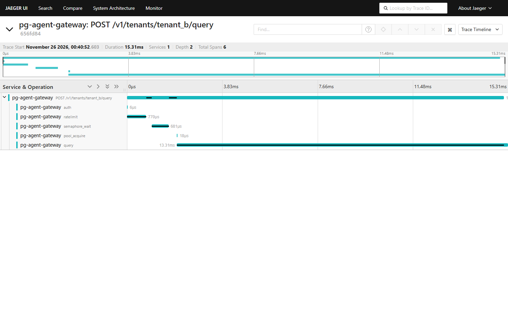
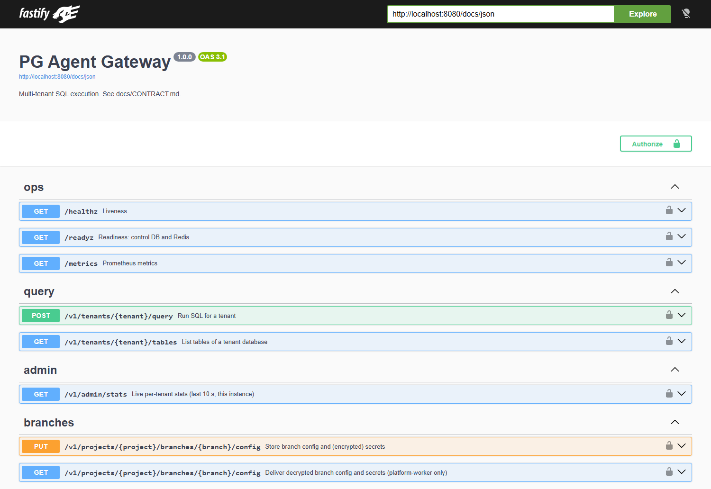
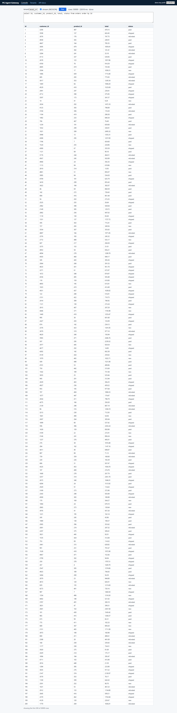
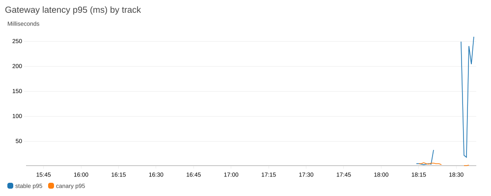
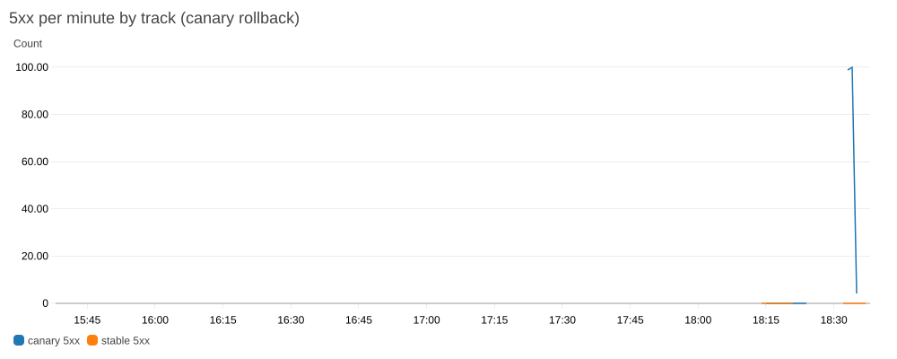

# PG Agent Gateway: a fair, observable SQL gateway for dashboards, MCP tools and AI agents

## The problem
AI agents changed the load profile of "run SQL for a customer". A dashboard sends a few queries a minute. An agent swarm sends hundreds a second, retries blindly, forgets to close connections and occasionally writes a query that never ends. In a multi-tenant service one tenant's swarm must not slow another tenant down, and a runaway query must not hold a connection forever. The service also needs a written contract callers can rely on, SLOs an on-call engineer can act on, and a deploy path that can fail safely.

PG Agent Gateway is a Fastify/TypeScript service that runs SQL against many tenants' Postgres databases for three kinds of caller (a web console, an MCP server, simulated agents) and stays reliable and fair at agent scale.

## Architecture



Locally the same code runs under Docker Compose with Prometheus, Grafana, Jaeger and Alertmanager instead of CloudWatch and X-Ray.

## What it does
- **Query API** with transactions, multi-statement requests, `maxRows` truncation, NDJSON streaming, per-request timeouts and server-side cancellation (`pg_cancel_backend`). Written down in [CONTRACT.md](CONTRACT.md) with one contract test per behaviour.
- **Fairness pipeline.** Every request passes API-key auth, a Redis token bucket per (tenant, caller type), a Redis concurrency semaphore per tenant with a bounded wait queue, and a per-tenant connection pool with a bounded queue. Saturation answers `429`/`503` with `Retry-After`. `@fastify/under-pressure` sheds load on event-loop lag or heap size.
- **Security.** Agents and MCP run in `READ ONLY` transactions on a read-only database role. Tenant credentials are envelope-encrypted (local AES-GCM key, KMS on AWS). API keys are stored as hashes. Branch secrets live in Secrets Manager on AWS.
- **Observability.** pino JSON logs without SQL text, Prometheus metrics with bounded labels (`tenant`, `caller_type`), OpenTelemetry spans for each pipeline stage, SLO recording rules and multi-window burn-rate alerts, runbooks and a postmortem.
- **Safe deploys.** An ALB with weighted target groups and a canary script that shifts 10% → 50% → 100% with a bake at each step and rolls back automatically on the `canary-5xx` alarm.

## Stack to requirement

| Requirement | Technology | Where |
|---|---|---|
| Run SQL for dashboard, MCP and agents | Fastify 5, `pg`, `pg-query-stream`, React 19 + Vite, `@modelcontextprotocol/sdk` | `apps/gateway`, `apps/console`, `apps/mcp-server` |
| Connection reuse, streaming, limits | per-tenant `pg.Pool`, NDJSON, `maxRows`, `SET LOCAL statement_timeout`, `pg_cancel_backend` | `apps/gateway/src/pipeline`, `src/pg` |
| Fair between tenants | Redis 7 Lua token bucket + semaphore, `@fastify/under-pressure` | `src/pipeline/limiter.ts` |
| Agent traffic | autocannon `agent-sim`, noisy-neighbour scenario | `tools/agent-sim` |
| SLOs, metrics, alerts, traces, logs | prom-client, Prometheus rules, Grafana, Alertmanager, OpenTelemetry/OTLP, Jaeger, pino, CloudWatch EMF, X-Ray | `observability/`, `src/obs` |
| Written contract | OpenAPI 3.1 (`@fastify/swagger`), `docs/CONTRACT.md`, Vitest contract tests | `docs/`, `tests/contract` |
| Branch config and secrets | AES-GCM envelope locally, KMS + Secrets Manager on AWS | `src/secrets` |
| Staged rollout | ALB weighted target groups, ECS Fargate stable + canary, CloudWatch alarm | `infra/lib/canary.ts`, `scripts/canary.sh` |
| IaC and CI | AWS CDK v2 (TypeScript), GitHub Actions | `infra/`, `.github/workflows/ci.yml` |
| Tests | Vitest, Playwright, agent-sim load smoke | `apps/gateway/test`, `tests/` |

## Proof
Everything below is generated by scripts; the index is [proof/README.md](../proof/README.md).










Highlights:
- **Noisy neighbour.** Tenant A at a mean 300 rps (peaks 540): 689 requests served, 8 995 rejected with 429. Tenant B at 20 rps: all 600 served, p95 66 ms against a 300 ms SLO ([report](../proof/phase1-local/tests/agent-sim-report.json)).
- **Cancellation.** `pg_sleep(10)` with `timeoutMs=500` returns 408 `STATEMENT_TIMEOUT` and logs `pg_cancel_backend` ([log](../proof/phase1-local/logs/timeout-cancel.log)).
- **Canary.** Tag `good` promoted through 10% → 50% → 100% ([log](../proof/phase2-cloud/logs/canary-promote.log)). Tag `bad` (`FAULT=500`) hit the `canary-5xx` alarm at the 10% step and was rolled back automatically ([log](../proof/phase2-cloud/logs/canary-rollback.log)).
- **Cloud contract tests.** The same 12 contract tests pass against the ALB ([report](../proof/phase2-cloud/tests/cloud-contract/junit.xml)).
- **Clean teardown.** [verify-destroyed.txt](../proof/phase3-destroy/verify-destroyed.txt).

## What was hard
- **The victim's latency was really the gateway's rejection cost.** Tenant B's p95 was over a second during the flood. Server-side traces showed the time in `ratelimit` and `semaphore_wait`, not in Postgres: rejecting tenant A's requests after parsing and validating bodies kept the single-threaded event loop busy. Moving admission (auth and token bucket) into an `onRequest` hook fixed it. Details in the [postmortem](postmortems/2026-11-noisy-neighbour.md).
- **A load generator can lie.** One process driving hundreds of connections inflated client-side latency. Each tenant's load now runs in its own process.
- **Cancel races.** Cancelling by backend pid alone can hit the next query on a reused connection. Each statement carries a request-id comment and the cancel only fires while that statement is still active.
- **Deploying from a laptop.** Details such as the first-use ECS service-linked role, Git Bash path rewriting and Windows paths handed to Node cost real time; the scripts now handle them.

## Cost
About two hours of AWS in `ap-southeast-2`: one `db.t4g.micro` RDS instance, four small Fargate tasks (stable, canary, Redis, plus a one-off init task), one ALB, CloudWatch logs and metrics, X-Ray traces, no NAT gateway. Roughly USD 1-2 in total; the KMS key is scheduled for deletion (7-day window) and does not bill after scheduling.

## Reproduce
```bash
pnpm install
scripts/dev-up.sh && scripts/test-all.sh          # local: stack, unit, contract, e2e, load smoke
scripts/capture-proof.sh phase1                   # screenshots, logs, drill
scripts/deploy.sh && scripts/capture-proof.sh phase2   # AWS: needs profile pg-agent-gateway-deployer
scripts/destroy.sh && scripts/verify-destroyed.sh
```
